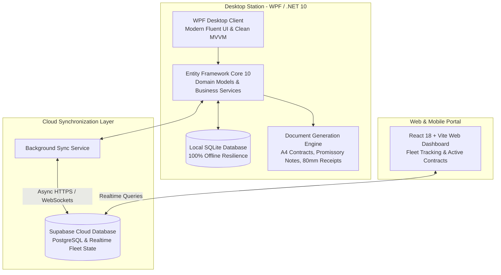

# 🚗 Car Rental Management System - Enterprise Fleet & Contract Suite

<div align="center">


--First)-003B57?style=for-the-badge&logo=sqlite&logoColor=white)


<p align="center">
  <b>A comprehensive, high-reliability fleet operations and car rental management system. Featuring offline-first contract processing, interactive vehicle damage inspection diagrams, real-time rental countdown timers, and automated A4 legal document generation.</b>
</p>

[English](#-overview-english) • [العربية](#-نظرة-عامة-باللغة-العربية) • [System Architecture](#-system-architecture) • [Key Features](#-core-capabilities) • [Technical Architecture](#-engineering-highlights) • [Quick Start](#-quick-start--installation)

---

</div>

## 🌐 Overview (English)

**Car Rental Management System** is a mission-critical operations platform built for modern vehicle rental agencies and fleet owners. It pairs a high-performance **C# / .NET 10 WPF desktop application** (running 100% offline with SQLite & EF Core) with a lightweight **React web dashboard** for remote fleet monitoring.

The system automates the complete rental lifecycle: from open-ended contracts and hour-precision billing calculations, to visual vehicle scratch inspection charts, legal promissory notes (كمبيالات), and multi-format document printing.

---

## 🇸🇦 نظرة عامة (باللغة العربية)

**نظام إدارة وتأجير السيارات الذكي** هو منصة تشغيلية ومحاسبية متكاملة مصممة خصيصاً لإدارة أساطيل مكاتب وشركات تأجير السيارات. يجمع النظام بين:
1. **تطبيق سطح مكتب قوي وسريع (WPF / .NET 10)** يعمل بنظام **Offline-First** بالكامل مع قاعدة بيانات محلية، يضمن استمرار العمل دون توقف، ويتيح طباعة العقود الرسمية وسندات القبض ومخططات فحص الأضرار التفاعلية.
2. **لوحة تحكم سحابية سريعة (Web Dashboard)** مبنية بـ **React & TailwindCSS** لمتابعة الأسطول والعقود النشطة من أي جهاز.
3. **طبقة مزامنة لحظية** تتصل سحابياً مع **Supabase** لتحديث حالة المركبات والعقود أولاً بأول.

---

## 🏗️ System Architecture



---

## ⚡ Core Capabilities

### 1. 📄 Smart Contract Engine & Lifecycle
* **Flexible Rental Terms:** Support for both fixed-duration and open-ended rental contracts with automatic extension calculations.
* **Precise Duration Engine:** Billing computed down to exact hours and minutes, factoring in grace periods, extra mileage, and late penalties.
* **One-Click Settlements:** Seamless contract checkout with deposit reconciliation, damage deductions, and payment settlement.

### 2. 🔍 Interactive Vehicle Condition Diagram (Visual Inspection)
* **Pixel-Perfect Damage Mapping:** Point-and-click damage locator on vehicle blueprints (front, rear, sides, roof) to record scratches, dents, and missing accessories.
* **Contract Integration:** Condition diagrams print directly onto official A4 check-out and check-in customer contracts.

### 3. ⏳ Live Rental Countdown & Gantt Timeline
* **Live Fleet Status:** Active vehicles on the road display live countdown timers in seconds to contract expiration.
* **Visual Gantt Timeline:** Interactive schedule view showing upcoming reservations, maintenance windows, and vehicle availability.

### 4. 🖨️ Multi-Format Legal & Financial Document Generation
* **Official A4 Legal Contracts:** Formatted for legal enforceability with terms, renter details, and inspection reports.
* **Financial Bonds & Promissory Notes (كمبيالات):** Automated bond generation with dynamic Arabic currency text formatting.
* **Dual Payment Vouchers:** Print official receipts in full A4 or via 80mm thermal receipt printers.

### 5. 📊 Fleet Financial Analytics & Vehicle ROI
* **Per-Vehicle Profitability:** Track net revenue, fuel, maintenance costs, and return on investment per car.
* **Debtor & Blacklist Ledger:** Customer verification against historical payment disputes or unreturned vehicle logs.

---

## 🚀 Engineering Highlights

* **Offline-First Resilience:** Zero dependency on constant internet connectivity. All operations, printing, and contracts run natively on local SQLite.
* **Modern .NET 10 Architecture:** Uses Entity Framework Core 10 with Code-First migrations and compiled queries for maximum execution speed.
* **Decoupled Web Layer:** Lightweight React 18 frontend communicates directly with Supabase, allowing owners to view contracts from smartphones.

---

## 📂 Repository Structure

```
Car-Rental-Management-System/
├── CarRentalSystem.slnx         # .NET solution file
├── build_installer.bat          # 1-Click build & Inno Setup compiler script
├── installer/                   # Deployment scripts & templates
│
├── src/                         # .NET Source Code
│   ├── CarRental.App/           # WPF Presentation Layer (Views, ViewModels, Converters)
│   ├── CarRental.Core/          # Domain Entities, Interfaces & Business Models
│   ├── CarRental.Data/          # EF Core DbContext, SQLite configurations, Migrations
│   └── CarRental.Services/      # Contract calculator, PDF/Print generator, Cloud sync
│
├── tests/                       # Unit & integration testing suites
│
└── web mange car/               # Web Management Dashboard
    ├── package.json             # React 18, Vite, TailwindCSS, Supabase JS
    ├── .env.example             # Supabase configuration template
    └── src/                     # React components, Fleet cards, and live stats
```

---

## 💻 Quick Start & Installation

### Prerequisites
* [.NET SDK 10.0](https://dotnet.microsoft.com/download) (or .NET 8.0+)
* [Node.js](https://nodejs.org/) (v18+) for the web dashboard
* Windows 10 / 11

### 1. Launching the Desktop Application
```bash
# Clone the repository
git clone https://github.com/zaidwork/Car-Rental-Management-System.git
cd Car-Rental-Management-System

# Restore dependencies & build
dotnet restore
dotnet build

# Run the desktop app
dotnet run --project src/CarRental.App/CarRental.App.csproj
```

### 2. Launching the Remote Web Dashboard
```bash
cd "web mange car"

# Install dependencies
npm install

# Setup environment variables
cp .env.example .env

# Run development server
npm run dev
```

---

## 🔒 Security & Privacy Notice

* All production database URLs, service keys, and test customer identities are decoupled.
* The repository contains clean schema definitions with no hardcoded credentials.

---

## 👨‍💻 Author & Maintainer

**Zaid Bashar Daraghmeh**  
* Full-Stack & Systems Engineer  
* GitHub: [@zaidwork](https://github.com/zaidwork)  
* Email: [zaidbashardaraghmeh@gmail.com](mailto:zaidbashardaraghmeh@gmail.com)
